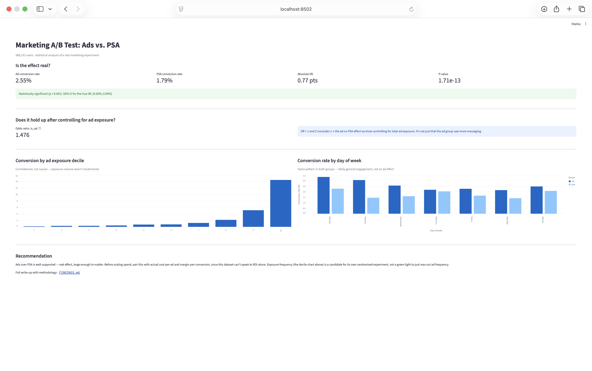

# Marketing A/B Test: Ads vs. PSA

Statistical analysis of a real 588,101-user marketing experiment — does showing ads (vs. a neutral public service announcement) actually drive more conversions, and is the effect big enough to matter?

**Full findings and methodology: [`FINDINGS.md`](FINDINGS.md)**

## TL;DR

Yes — ads produce a statistically significant, practically meaningful lift in conversion rate (2.55% vs. 1.79%, p = 1.71×10⁻¹³), and the effect holds up even after controlling for how many ads someone saw. A secondary finding — conversion rising sharply with ad exposure — is flagged as correlational, not causal, since exposure volume wasn't randomized the way group assignment was.

## Why this project

Most portfolio A/B test projects stop at "ran a t-test, p < 0.05, done." This one goes further: it distinguishes statistical significance from practical significance, checks a real confound with a logistic regression rather than just noting it as a caveat, and is explicit about which findings are causal (protected by randomization) versus correlational (not) — a distinction that matters a lot more in practice than most tutorials treat it.

## Screenshots



## Stack

| Layer | Tool | Why |
|---|---|---|
| Storage | PostgreSQL | Real SQL exploration, not just pandas |
| Statistics | Python (scipy, statsmodels) | Two-proportion z-test, logistic regression |
| SQL | Window functions, CTEs | `NTILE()` for exposure-decile analysis |
| Dashboard | Streamlit + Altair | Live-computed from the database, not hardcoded |
| Containerization | Docker Compose | One command, reproducible from clone |

## Running it

```bash
git clone https://github.com/gelam921/ab-test-conversion-analysis.git
cd ab-test-conversion-analysis
cp .env.example .env
docker compose up -d --build
docker compose run --rm analysis python analysis/load_data.py
```

- **Dashboard:** http://localhost:8502
- **Hypothesis test:** `docker compose run --rm analysis python analysis/hypothesis_test.py`
- **Regression:** `docker compose run --rm analysis python analysis/regression.py`
- **SQL exploration:** `docker exec -i abtest_postgres psql -U analyst -d ab_test_db < analysis/exploration.sql`

Dataset: [Marketing A/B Testing](https://www.kaggle.com/datasets/faviovaz/marketing-ab-testing) (Kaggle), included in this repo under `data/`.

## Project structure

├── docker-compose.yml  
├── Dockerfile.analysis  
├── FINDINGS.md  
├── data/  
│ └── marketing_AB.csv  
├── analysis/  
│ ├── load_data.py  
│ ├── hypothesis_test.py  
│ ├── regression.py  
│ └── exploration.sql  
└── dashboard/    
└── app.py